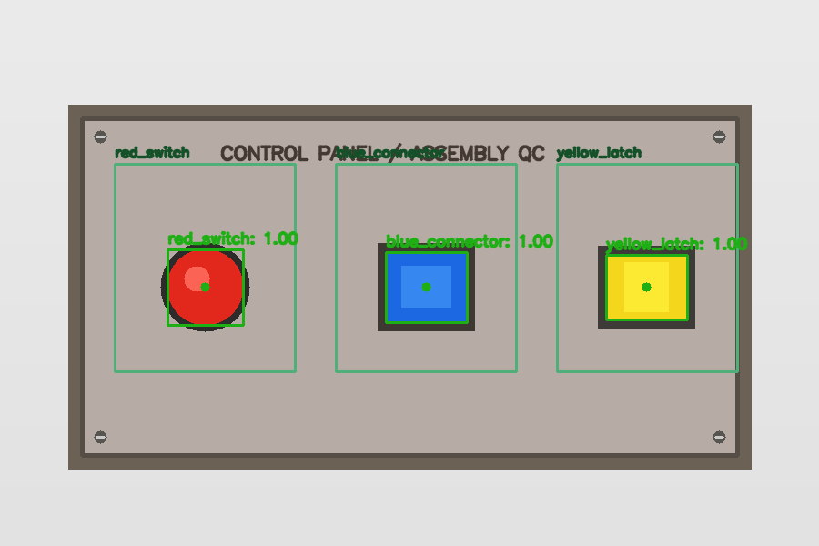
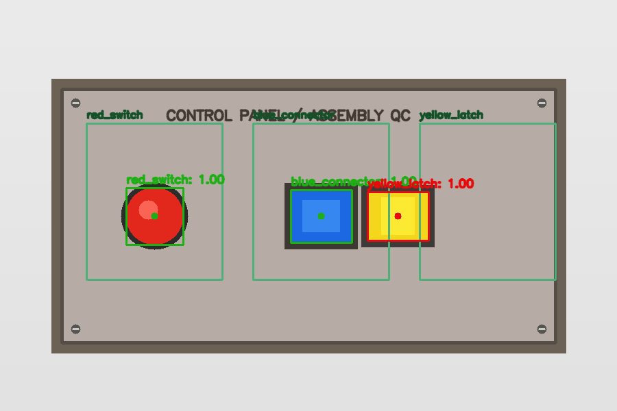

# AI-Based Assembly Line Error Detection System

**Computer Vision + AI · Manufacturing quality-control prototype**

A fixed-camera assembly inspection system for a three-component control panel. It checks **component presence** and **whether the detected component's bounding-box center is inside its approved placement zone**. It records inspections and warns if **more than 10%** of units in a batch are flagged. Flagged cases require final human review.

> **IMPORTANT — two clearly separate execution modes:** The default `demo_color` mode runs OpenCV HSV segmentation on synthetic colored test fixtures and is **not a trained AI model**. The project also includes a genuine Ultralytics YOLO inference adapter, training script, and model evaluation script, but **real YOLO inspection cannot run until custom labeled images have been collected and a three-class model has been trained**. Generic COCO object labels do not identify these manufacturing components. Do not represent demo performance as model accuracy.

## What makes this project different from package packing verification?

| | Assembly inspection | Warehouse package packing |
|---|---|---|
| Application | Manufacturing product quality | Verify shipping contents |
| What is checked? | Component presence **and coordinates** | Item presence and quantity |
| Core rule | Bounding-box center must be inside **specific placement zone** | Compare item checklist |
| Additional requirement | **Batch defect warning (>10%)** | Missing or unexpected package items |
| Dataset | Fixed-camera images of **the same assembly type** | Images of package contents |
| Labels | `red_switch`, `blue_connector`, `yellow_latch` | General object labels such as bottle or book |

## Visual examples (synthetic demo only)

**Correct assembly:**



**Misplaced component:**



Green outlines identify approved center-placement regions. The red bounding box flags a misplaced component. These images demonstrate backend logic only, **not** learned AI accuracy.

## Architecture

```text
JPG / PNG assembly images
        |
        v
FastAPI inspection endpoint (single / batch)
        |
        v
Detector adapter
  [demo_color: synthetic OpenCV only] OR [yolo: custom-trained model]
        |
        v
Component inventory check + box-center / normalized-zone check
        |
        +--> Pass
        +--> Needs Review: missing / misplacement / low confidence / extra
        |
        v
Batch flags (>10%) + SQLite inspection history + annotated image + CSV
        |
        v
Optional Streamlit dashboard (API client)
```

### Demonstration fixture

The example unit is a simple color-coded control panel. Its three required parts are:

| Component | Required count | Approved center zone `[x1,y1,x2,y2]` |
|---|---:|---|
| `red_switch` | 1 | `[0.14, 0.30, 0.36, 0.68]` |
| `blue_connector` | 1 | `[0.41, 0.30, 0.63, 0.68]` |
| `yellow_latch` | 1 | `[0.68, 0.30, 0.90, 0.68]` |

Zones are image-relative, so `x=0` means left edge and `x=1` right edge. A detection counts as correctly placed only if its bbox **center** lies in the expected zone. **A part that exists outside its placement zone is *misplaced*, not *missing*.** Zone dimensions must be calibrated using the actual fixed-camera viewpoint and expected manufacturing tolerances.

## Requirements

- Python 3.11 (Windows PowerShell commands below)
- FastAPI, OpenCV, SQLite, pytest
- Optional: Streamlit
- Optional for REAL AI: PyTorch + Ultralytics and your own labeled assembly photos

## Quick start on Windows / VS Code

In PowerShell, inside the downloaded project directory:

```powershell
py -3.11 -m venv .venv
.\.venv\Scripts\Activate.ps1
python -m pip install --upgrade pip
pip install -r requirements.txt
Copy-Item .env.example .env
uvicorn assembly.api:app --reload
```

If the activation script is blocked by your PowerShell policy, use the virtual environment interpreter without activation:

```powershell
.\.venv\Scripts\python.exe -m pip install -r requirements.txt
.\.venv\Scripts\python.exe -m uvicorn assembly.api:app --reload
```

Open **http://127.0.0.1:8000/docs** (the Swagger API explorer). The default detector is `demo_color` to allow immediate end-to-end tests on included sample images. Use `GET /health` to confirm the active mode.

### Run the demo immediately

Included images:

- `demo/examples/pass.png` — all three colored components in their correct zones; expect `Pass`.
- `demo/examples/missing_blue.png` — blue connector absent; expect `Needs Review` with missing component.
- `demo/examples/misplaced_yellow.png` — yellow latch outside allowed zone; expect `Needs Review` with misplacement.
- `demo/examples/misplaced_red.png` — red switch outside allowed zone; expect `Needs Review` with misplacement.

In `/docs` expand `POST /inspect` → **Try it out** → upload one image → **Execute**. The response includes `status`, `reason_codes`, `missing`, `misplaced` (with normalized center), `detections`, `processing_ms`, and `annotated_image_url`.

You can regenerate the synthetic demo examples with:

```powershell
python -m demo.generate_samples
```

### Optional Streamlit dashboard

In one terminal, keep FastAPI running. Open a second terminal:

```powershell
pip install -r requirements-dashboard.txt
streamlit run dashboard/app.py
```

The dashboard uploads one or more images, displays annotated boxes and placement zones, reports flagged units and the >10% warning, and downloads historical CSV results. It is **not necessary to test the backend endpoints**.

## API

| Endpoint | Method | Purpose |
|---|---|---|
| `/` | GET | Project and docs link |
| `/health` | GET | Service and detector-mode information |
| `/assembly/layout` | GET | Configured component counts and normalized zones |
| `/inspect` | POST | One multipart `file` upload and component verification |
| `/batches/inspect` | POST | Multiple multipart `files`; warns when flagged fraction **> 0.10** |
| `/batches/{batch_id}` | GET | Reload persisted batch decisions, including invalid uploads |
| `/inspections` | GET | Inspection history |
| `/inspections/{inspection_id}` | GET | One inspection JSON |
| `/inspections/{inspection_id}/annotated` | GET | Annotated PNG with zones, boxes and centers |
| `/summary` | GET | Cumulative inspected/passed/flagged counts |
| `/inspections/export.csv` | GET | CSV report |

**Rule semantics:** Detections at or above `ASSEMBLY_CONFIDENCE=0.55` count toward required components. Detections between `ASSEMBLY_LOW_CONFIDENCE=0.25` and the accepted threshold trigger uncertainty and human review. A required part not confidently detected is flagged; this is not definitive proof that it was physically absent (it may be occluded). Unknown and extra detections also cause review. An image that cannot be decoded is **never** automatically approved.

**Batch quality:** 1 flagged image out of 10 = 10.0% → no batch warning; 2 out of 10 = 20.0% → warning. Individual `Needs Review` results are still returned regardless of batch percentage.

## Automated testing

```powershell
python -m pytest -q
```

The suite covers presence/absence, wrong zone, low confidence, duplicate part, unknown label, zero detections, boundary values for the 10% warning, the FastAPI health/layout/inspect/batch endpoints, invalid files, SQLite batch persistence, annotated images, and CSV export. It exercises the **synthetic color demo**, not YOLO accuracy.

## Real AI model: custom YOLO workflow

The proposal calls for **YOLO transfer learning and evaluation**. That is included as training/evaluation *code*, but actual training must be completed with suitable labeled images.

1. Capture the same type of assembly from the fixed production camera. Include good, missing-part, misplaced-part and difficult examples with glare/occlusion.
2. Annotate red switch, blue connector and yellow latch boxes. Split images into train, validation, **held-out test** groups without duplicate sessions. See `dataset/README.md` for directory structure and `assembly_dataset.yaml`.
3. Install the real-model dependencies:

   ```powershell
   pip install -r requirements-ml.txt
   ```
4. Train on your labeled dataset. For a GPU use `--device 0` if CUDA is correctly configured, otherwise keep `cpu`:

   ```powershell
   python -m training.train_yolo --data dataset/assembly_dataset.yaml --epochs 40 --device cpu
   ```

   The training script uses `yolov8n.pt` as a pretrained initialization, then learns the three custom component classes from your data. It reports where `runs/assembly_training/weights/best.pt` was saved.
5. Copy the trained `best.pt` file into `weights/best.pt`, then edit `.env`:

   ```text
   ASSEMBLY_DETECTOR=yolo
   ASSEMBLY_WEIGHTS=weights/best.pt
   ```

   **Restart** Uvicorn to switch detectors. The API checks the custom model's class names and returns an actionable error if the wrong weights are used.
6. Evaluate detector **precision, recall, mAP@50 and mAP@50–95** on the held-out test set:

   ```powershell
   python -m training.evaluate_yolo --split test
   ```
7. Evaluate the **assembly decision accuracy**, false-flag rate and average processing time against reviewer-labeled images. Supply a JSON manifest with entries like:

   ```json
   [{"filename":"unit_001.png","expected_status":"Pass"},
    {"filename":"unit_002.png","expected_status":"Needs Review"}]
   ```

   Run:

   ```powershell
   python -m training.evaluate_decisions --manifest path/to/reviewer_manifest.json
   ```

   Images referenced by the manifest must be in the same directory as the manifest. Results are written to `decision_evaluation_results.json`.

### Toy YOLO training smoke test (optional)

```powershell
python -m demo.generate_samples --toy-training
python -m training.train_yolo --data dataset/assembly_dataset.yaml --epochs 15 --device cpu
```

This creates **artificial** labeled images suitable for verifying that the training code runs. It does not measure the reliability of a manufacturing application. Do not confuse toy data evaluation with the held-out *real* dataset required by the proposal. Training may take substantial CPU time.

## Repository map

```text
assembly/               API, demo and YOLO detectors, zone verification, overlays, SQLite
config/layout.json      Count and normalized positional rules for one assembly
training/               Train YOLO, evaluate precision/recall/mAP, evaluate decisions
dataset/README.md       Real image capture / annotation / split instructions
demo/generate_samples.py  Synthetic fixture generator and optional toy YOLO dataset
demo/examples/          Four included generated demo images, review labels and annotated examples
 dashboard/app.py       Optional Streamlit client
 tests/                 Pytest verification and API integration tests
 weights/README.md      Where custom trained weights belong
requirements.txt        Lean backend dependencies
requirements-ml.txt     Adds Ultralytics for genuine YOLO
requirements-dashboard.txt  Adds Streamlit UI
.env.example            Environment variable template; no secrets
.gitignore              Excludes user environment, databases, model weights, datasets
```

## Known limitations, academic honesty and future work

- The included images are artificially drawn examples. A demo decision passing does **not** establish YOLO performance.
- The real detector requires a trained YOLO checkpoint and a separately curated real dataset. Those are **not included**.
- Placement correctness is determined by a 2D bounding-box center, not by mechanical fastening, depth or orientation. A part can appear in the right region while still being improperly attached.
- Visibility and optical conditions (glare, occlusion, similar components, tiny parts, camera changes) can cause false errors and missed errors. Continue human review.
- The quality warning is a **batch flag rate**, not an empirically calibrated manufacturing defect rate.
- This is a single-user local research prototype, without authentication or industrial integration. Do not connect it to a live manufacturing line.
- Real-time conveyor, multi-product deployment, and robust automated acceptance are outside the current scope.

**References:** [Ultralytics model training](https://docs.ultralytics.com/modes/train/) · [model validation](https://docs.ultralytics.com/modes/val/) · [custom dataset training configuration](https://docs.ultralytics.com/usage/cfg/)
